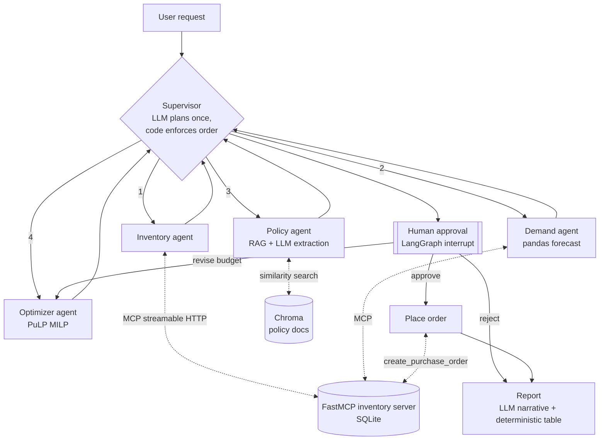

# ReplenishIQ: Multi-Agent Inventory Replenishment Copilot

ReplenishIQ is a demo copilot that drafts a store's weekly replenishment order. A **LangGraph supervisor** coordinates specialist agents:

- an **inventory agent** that reads stock and supplier terms through an **MCP server** (Streamable HTTP)
- a **demand agent** that forecasts sales with pandas
- a **policy agent** that pulls replenishment and budget rules from internal documents with **RAG**
- an **optimizer agent** that solves a **mixed-integer program** (PuLP) for order quantities

A **human approves** the plan before any purchase order is written. An LLM (Groq) handles language: it parses the request, extracts policy rules, and explains the result. **Every number comes from a tool or the solver.**

> This is a portfolio/interview project that runs on synthetic data. It is not a production system, and it makes no claims about business impact.

## Architecture



| Component | Tech | Where |
|---|---|---|
| Orchestration | LangGraph `StateGraph`, `Command` routing, `interrupt` + `MemorySaver` | `agents/graph.py`, `agents/supervisor.py` |
| Tools | FastMCP server (Streamable HTTP at `/mcp`, optional bearer token) | `mcp_servers/inventory_server.py` |
| Tool client | `langchain-mcp-adapters` `MultiServerMCPClient` | `agents/mcp_client.py` |
| RAG | Chroma with local all-MiniLM-L6-v2 (ONNX) embeddings, one chunk per markdown section | `rag/` |
| Forecast | Day-of-week seasonality plus exponential smoothing, with a 7-day backtest WAPE | `agents/forecasting.py` |
| Optimization | PuLP + CBC MILP | `agents/milp.py` |
| LLM | Groq via `langchain-groq` (default `llama-3.3-70b-versatile`) | `agents/llm.py` |

### MCP tools
`get_stock`, `list_store_inventory`, `list_low_stock`, `get_sales_history`, `get_supplier_terms` are read-only (annotated `readOnlyHint`). `create_purchase_order` is the only write tool, and the graph calls it only after a human approves. The server checks MOQ and case-pack rules again on its own and does not trust the agent.

### The optimization model
For each SKU *i*, the model chooses an integer number of cases `c_i` (order quantity `q_i = pack_i · c_i`) and a binary order flag `y_i`.

- **Minimize** `Σ cost_i·q_i + penalty_i·(shortfall_lead_i + 0.5·shortfall_target_i)`
- `q_i ≥ MOQ_i·y_i` and `q_i ≤ M·y_i` (MOQ applies only when ordering)
- `position_i + q_i − demand_lead_i ≤ shelf_capacity_i`
- `cost_i·q_i ≤ max_share · budget` (concentration limit from the budget policy)
- `Σ cost_i·q_i ≤ budget`
- The shortfall terms are soft constraints against the target `demand_lead + demand_horizon + safety_stock` (with promo uplift applied). This keeps the model feasible when the budget is tight. The penalties make the solver cover lead-time demand first, and they weight Grocery higher.

Each order line reports what limited it (shelf capacity, concentration limit, or budget), so the plan can be explained.

## Quickstart

### Colab (recommended)
1. Open `notebooks/ReplenishIQ_demo.ipynb` in Colab.
2. Add `GROQ_API_KEY` under **Secrets** (key icon) and turn on notebook access. Get a free key at https://console.groq.com.
3. Run all cells. The notebook installs requirements, generates data, builds the index, starts the MCP server as a background process, runs the graph to the approval interrupt, revises, approves, and shows the report and the PO.

The notebook also runs **without a key**. Rule-based stand-ins replace the 3 LLM steps (offline mode), and the rest of the system is identical.

### Local
```bash
python -m venv .venv && source .venv/bin/activate
pip install -r requirements.txt
cp .env.example .env            # add GROQ_API_KEY (optional)
python -m scripts.generate_data # -> data/replenishiq.db
python -m rag.build_index       # -> chroma_db/
python -m mcp_servers.inventory_server &   # http://localhost:8000/mcp (health: /health)
python -m app.run_demo                     # interactive approve / reject / revise:<budget>
python -m app.run_demo --offline --decision revise:4000,approve   # no LLM, scripted decisions
python -m pytest -q
```
Turn on MCP auth by setting the same `MCP_AUTH_TOKEN` for both the server and the client. The client then sends `Authorization: Bearer <token>`.

Docker: `docker compose up -d mcp && docker compose run --rm app`

## Staying within Groq's free tier
The Groq free tier needs **no billing or credits**, but it has **rate limits** (requests and tokens per minute and per day, which vary by model). This project is built to stay well under them:

- **3 LLM calls per run:** supervisor plan, policy extraction, and report narrative. Revise loops re-run only the solver, so they make no extra LLM calls. Forecasting, optimization, and tool calls never use the LLM.
- **Short prompts.** The policy agent sends only the ~6 retrieved policy sections (about 1.3k characters). The report gets a compact JSON summary of the plan. Sales history never reaches the LLM.
- `max_tokens=768` (`GROQ_MAX_TOKENS`), `temperature=0`, and `max_retries=4`. The Groq SDK backs off exponentially on 429 and 5xx errors.
- If a call still fails (rate limit, timeout, or malformed output), that step falls back to the rule-based version, adds a warning to the run, and the run continues.
- **If you hit limits,** switch to `llama-3.1-8b-instant`. You can do this for the cheap routing step only (`GROQ_ROUTER_MODEL=llama-3.1-8b-instant`) or for everything (`GROQ_MODEL=llama-3.1-8b-instant`).

## Design decisions and tradeoffs
- **Supervisor with deterministic guardrails rather than free-form agent chat.** The LLM proposes a plan once. Code then validates the store, budget, and horizon, fixes the dependency order, routes to the first worker whose output is missing, and caps the run at 12 steps. This makes runs predictable, cheap, and easy to debug. The cost is less flexibility than a ReAct loop.
- **The LLM never produces numbers.** Order quantities come from the MILP, forecasts from pandas, and stock from MCP. Policy numbers the LLM extracts are **grounded**: each value must appear literally in the retrieved text and fall in a sane range. Otherwise the rule-based value is used and the run logs a warning. Tests cover this with a deliberately wrong LLM.
- **MCP over HTTP with a stateless server.** Tools sit behind a protocol boundary, so other agents or IDEs can reuse them, and the server can scale and be secured on its own. Read and write tools are separated, and the server enforces its own business rules.
- **Human in the loop at the only side effect.** `interrupt()` pauses the graph with a compact approval payload. MemorySaver keeps the state, and `Command(resume=...)` continues with approve, reject, or revise (new budget, re-optimize).
- **Simple, explainable forecast.** Seasonal exponential smoothing with a backtest WAPE is enough to demo the pipeline. Swapping in a stronger model (for example LightGBM or a hierarchical forecast) would only change `agents/forecasting.py`.
- **Local embeddings.** MiniLM through Chroma needs no API key and gives the same results on every run.

## Evaluation ideas (not implemented)
- Forecast: rolling-origin backtests (WAPE and bias per category) against a naive baseline.
- Optimizer: simulate fill rate and stockouts against held-out demand, and compare with a min/max heuristic.
- Agents: a golden set of requests and expected plans, a grounding-failure rate, LLM calls and tokens per run, and tracing with LangSmith or OpenTelemetry.

## Limitations (honest)
- All data is synthetic (10 SKUs, 2 stores, 180 days).
- Promotions apply their uplift to the whole planning horizon instead of exact promo dates.
- Single-echelon (store-level only), with deterministic lead times and no supplier capacity or perishability modeling.
- MemorySaver is in-memory. Production would use a persistent checkpointer such as Postgres.
- The bearer-token auth is a static token, for demo use only.
- Groq structured-output quality depends on the model. The fallbacks keep runs going, but check the warnings.

## Next steps
Containerize, then deploy to Kubernetes. Add OAuth 2.1 for MCP. Add LangSmith/OTel tracing, a persistent checkpointer, and a real tool-calling (ReAct) inventory agent for ad-hoc questions. Add multi-store optimization and supplier capacity constraints.

## Repo layout
```
agents/        supervisor, workers, MILP, forecasting, LLM wrappers, graph
mcp_servers/   FastMCP inventory server
rag/           index builder + retriever
scripts/       synthetic data generator
data/policies/ policy markdown docs (RAG corpus)
app/           CLI demo
notebooks/     Colab demo
tests/         optimizer, MCP (incl. auth), end-to-end offline graph
```
