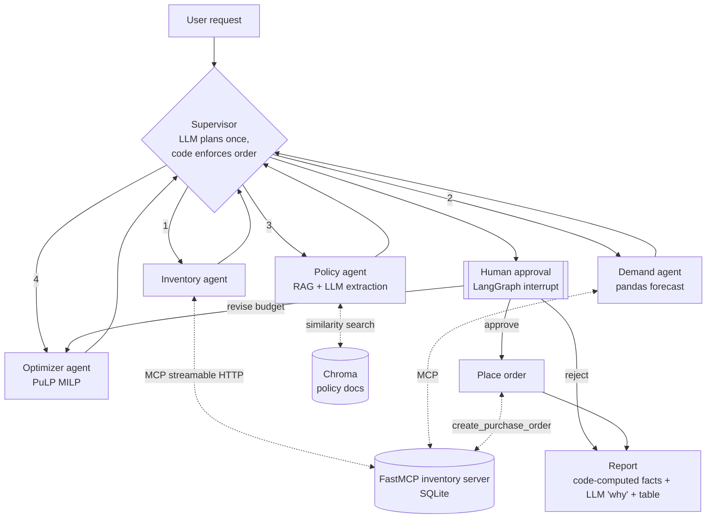

# ReplenishIQ: Multi-Agent Inventory Replenishment Copilot

ReplenishIQ is a demo copilot that drafts a store's weekly replenishment order. A **LangGraph supervisor** coordinates specialist agents:

- an **inventory agent** that reads stock and supplier terms through an **MCP server** (Streamable HTTP)
- a **demand agent** that forecasts sales with pandas
- a **policy agent** that pulls replenishment and budget rules from internal documents with **RAG**
- an **optimizer agent** that solves a **mixed-integer program** (PuLP) for order quantities

A **human approves** the plan before any purchase order is written. An LLM (Groq) handles language: it parses the request, extracts policy rules, and explains the result. **Every number comes from a tool or the solver.**

> This is a portfolio project that runs on synthetic data. It is not a production system, and it makes no claims about business impact.

## Architecture



| Component | Tech | Where |
|---|---|---|
| Orchestration | LangGraph `StateGraph`, `Command` routing, `interrupt` + `MemorySaver` | `agents/graph.py`, `agents/supervisor.py` |
| Tools | FastMCP server (Streamable HTTP at `/mcp`, JWT role/scope auth) | `mcp_servers/inventory_server.py` |
| Tool client | `langchain-mcp-adapters` `MultiServerMCPClient` | `agents/mcp_client.py` |
| RAG | Chroma with local all-MiniLM-L6-v2 (ONNX) embeddings, one chunk per markdown section | `rag/` |
| Forecast | Day-of-week seasonality plus exponential smoothing, with a 7-day backtest WAPE | `agents/forecasting.py` |
| Optimization | PuLP + CBC MILP | `agents/milp.py` |
| LLM | Groq via `langchain-groq` (default `openai/gpt-oss-120b`, router `openai/gpt-oss-20b`) | `agents/llm.py` |
| UI (optional) | Chainlit chat with steps per node and approve/reject/revise buttons | `ui/chainlit_app.py` |

### MCP tools
`get_stock`, `list_store_inventory`, `list_low_stock`, `get_sales_history`, `get_supplier_terms` are read-only (annotated `readOnlyHint`), and so is `list_purchase_orders` (PO log for auditors). `create_purchase_order` is the only write tool, and the graph calls it only after a human approves. The server checks MOQ and case-pack rules again on its own and does not trust the agent.

### The optimization model
For each SKU *i*, the model chooses an integer number of cases `c_i` (order quantity `q_i = pack_i · c_i`) and a binary order flag `y_i`.

- **Minimize** `Σ cost_i·q_i + penalty_i·(shortfall_lead_i + 0.5·shortfall_target_i)`
- `q_i ≥ MOQ_i·y_i` and `q_i ≤ M·y_i` (MOQ applies only when ordering)
- `position_i + q_i − demand_lead_i ≤ shelf_capacity_i`
- `cost_i·q_i ≤ max_share · budget` (concentration limit from the budget policy)
- `Σ cost_i·q_i ≤ budget`
- The shortfall terms are soft constraints against the target `demand_lead + demand_horizon + safety_stock` (with promo uplift applied). This keeps the model feasible when the budget is tight. The penalties make the solver cover lead-time demand first, and they weight Grocery higher.

Each order line reports what limited it (shelf capacity, concentration limit, or budget), so the plan can be explained.

## Quickstart

### Colab (recommended)
1. Open `notebooks/ReplenishIQ_demo.ipynb` in Colab.
2. Add `GROQ_API_KEY` under **Secrets** (key icon) and turn on notebook access. Get a free key at https://console.groq.com.
3. Run all cells. The notebook installs requirements, generates data, builds the index, starts the MCP server as a background process, runs the graph to the approval interrupt, revises, approves, and shows the report and the PO. Later sections demo JWT roles and open the Chainlit chat UI.

The notebook also runs **without a key**. Rule-based stand-ins replace the 3 LLM steps (offline mode), and the rest of the system is identical.

### Run locally (plain Python)
```bash
python -m venv .venv && source .venv/bin/activate
pip install -r requirements.txt
cp .env.example .env            # add GROQ_API_KEY (optional)
python -m scripts.generate_data # -> data/replenishiq.db
python -m rag.build_index       # -> chroma_db/
python -m mcp_servers.inventory_server &   # http://localhost:8000/mcp (health: /health)
python -m app.run_demo                     # interactive approve / reject / revise:<budget>
python -m app.run_demo --offline --decision revise:4000,approve   # no LLM, scripted decisions
python -m pytest -q
```
To run with role-based JWT auth, see [Authentication & authorization](#authentication--authorization):
```bash
python -m scripts.mint_tokens                            # .secrets/ (gitignored): keypair + 3 role tokens
MCP_AUTH=jwt python -m mcp_servers.inventory_server &
MCP_AUTH=jwt python -m app.run_demo --offline --decision approve
```

### Chat UI (Chainlit, optional)
```bash
pip install -r requirements-ui.txt          # chainlit~=2.12.0 on top of the core requirements
chainlit run ui/chainlit_app.py --port 8501 # http://localhost:8501 (Chainlit's default 8000 is the MCP server's port)
```
If the MCP server isn't already answering at `MCP_SERVER_URL`, the app starts it, and builds the demo data and index first if they're missing. Each graph node shows up as a step with its trace. The plan arrives as a table with **Approve / Reject / Revise** buttons; Revise asks for a new budget. The buttons map to the same `Command(resume=...)` payloads as the CLI. The final message shows the report, the PO id, and which MCP role token each step used. Set `MCP_AUTH=jwt` (after `python -m scripts.mint_tokens`) to see planner vs. approver tokens, and set `RIQ_OFFLINE=1` to force the rule-based LLM stand-ins.

**Chainlit on Colab.** The notebook (section 11) starts the app in the background with `chainlit run ui/chainlit_app.py --port 8501 --headless` and opens it with `google.colab.output.serve_kernel_port_as_window(8501)`. It also prints the `google.colab.kernel.proxyPort(8501)` link; `serve_kernel_port_as_iframe(8501)` embeds the app in the notebook instead. Caveats:
- Colab's port proxy doesn't reliably pass WebSocket upgrades (see googlecolab/colabtools#2529 and #4270), and Chainlit uses Socket.IO. The notebook sets `CHAINLIT_TRANSPORTS=polling`, which the app copies into Chainlit's `project.transports`, so the browser uses HTTP long-polling. That's slower, but it works through plain HTTP proxies.
- `serve_kernel_port_as_window` warns that browsers may block it. Use the printed proxy link or the iframe if no tab opens.
- The proxied app lives at the root of its own `*.colab.googleusercontent.com` origin, so `--root-path` isn't needed. Use `--root-path /prefix` (and `CHAINLIT_URL` for OAuth callbacks) only behind a reverse proxy that mounts the app under a path.
- Fallback: an optional `cloudflared tunnel --url http://127.0.0.1:8501` quick-tunnel cell (no account) gives a temporary public `trycloudflare.com` URL with working WebSockets. Anyone with the link can reach the app, so stop it when you're done. It needs outbound TCP/UDP 7844, which some locked-down networks block.
- The app and its MCP server live only as long as the Colab runtime does. **Run all** leaves them running and ends with the app link; the cleanup cell (section 12) stops them only after you set `STOP_SERVERS = True`.

### Run locally with Docker (optional)
Colab never uses the Dockerfile; it only matters when you run Docker yourself. Locally, the MCP server and the agent app each run in their own container, the same way they would scale separately in production:
```bash
cp .env.example .env            # add GROQ_API_KEY (optional)
docker compose up -d mcp        # MCP server on http://localhost:8000/mcp
docker compose run --rm app     # runs the demo against the containerized MCP server
```

## Authentication & authorization
`MCP_AUTH=jwt` turns on JWT auth. The MCP server checks every request's RS256 bearer token (signature, issuer `replenishiq-local-idp`, audience `replenishiq-mcp`, expiry) with FastMCP's `JWTVerifier`. Then FastMCP's `AuthMiddleware` checks the tool's scope (`mcp_servers/auth.py`):

| Role | Scopes | Tools it can see and call |
|---|---|---|
| planner | `inventory:read` | `get_stock`, `list_store_inventory`, `list_low_stock`, `get_sales_history`, `get_supplier_terms` |
| approver | `inventory:read po:write` | all of the planner's tools + `create_purchase_order` |
| auditor | `po:read` | `list_purchase_orders` |

- **Deny by default.** Every tool has to be listed in `TOOL_SCOPES`, otherwise nobody can call it. `tools/list` hides tools the caller has no scope for. Calling one anyway returns `forbidden: missing scope po:write for tool 'create_purchase_order' (caller=planner, ...)`. A request with no token, or a token signed by another key, gets HTTP 401.
- **Least privilege in the agent.** The inventory and demand agents connect with the **planner** token, so they never even see the write tool. Only `place_order` uses the **approver** token, and it runs only after the human-approval interrupt. Trace lines show which credential each step used, e.g. `place_order: MCP create_purchase_order as role=approver scopes=inventory:read po:write -> PO-...`.
- **Local keys and tokens.** `scripts/mint_tokens.py` stands in for the identity provider. It generates the keypair and 3 tokens (8 h by default, `--hours`) into `.secrets/`, which is gitignored and never committed. The server only needs `jwt_public.pem`.
- **Other modes.** `MCP_AUTH=none` (the default, used by most tests) and `MCP_AUTH=static` (one shared `MCP_AUTH_TOKEN` with all scopes, kept for backward compatibility).

**Production auth.** In production you wouldn't mint tokens locally. They would come from the enterprise IdP (Entra ID, Okta, Ping, ...) via OAuth 2.1, and the MCP server would be a pure *resource server*: it validates tokens against the IdP's JWKS (`JWTVerifier(jwks_uri=...)`) and never issues them. The agent would call MCP with the user's delegated token (on-behalf-of) for actions taken for a person, such as approving a PO, so the approver identity comes from the token rather than a free-text field. For service actions, such as nightly reads, it would use client-credentials tokens. Tokens are short-lived (minutes, not hours) and audience-bound to the MCP server. Every tool call is audit-logged with subject, scopes, tool, arguments, and result. Scopes or roles map to IdP groups.

## Staying within Groq's free tier
The Groq free tier needs **no billing or credits**, but it has **rate limits** (requests and tokens per minute and per day, which vary by model). This project is built to stay well under them:

- **3 LLM calls per run:** supervisor plan, policy extraction, and the report's short "why" explanation. Revise loops re-run only the solver, so they make no extra LLM calls. Forecasting, optimization, and tool calls never use the LLM.
- **Short prompts.** The policy agent sends only the ~6 retrieved policy sections (about 1.3k characters). The report gets a compact JSON block of precomputed facts. Sales history never reaches the LLM.
- **Models:** `GROQ_MODEL` defaults to `openai/gpt-oss-120b` (policy extraction and report). `GROQ_ROUTER_MODEL` defaults to `openai/gpt-oss-20b` (supervisor plan). Both can be overridden with env vars. Other free-tier options include `qwen/qwen3.8-27b` and `meta-llama/llama-4-scout-17b-16e-instruct`. Groq retires models regularly (`llama-3.3-70b-versatile` and `llama-3.1-8b-instant` were shut down on Aug 16, 2026), so check https://console.groq.com/docs/deprecations if you get a `NotFoundError`.
- **Reasoning models:** gpt-oss and qwen3 reason before answering, and reasoning tokens count toward `max_tokens`. The client sets `reasoning_effort="low"` (`GROQ_REASONING_EFFORT`) and hides the reasoning: `include_reasoning=False` for gpt-oss, `reasoning_format="hidden"` for qwen3. Other models get neither parameter. Structured steps use Groq JSON-schema structured outputs (`strict` mode with constrained decoding on gpt-oss). Other models use tool calling.
- `max_tokens=1024` (`GROQ_MAX_TOKENS`), `temperature=0`, and `max_retries=4`. The Groq SDK backs off exponentially on 429 and 5xx errors.
- If a call still fails (rate limit, timeout, or malformed output), that step falls back to the rule-based version, adds a warning to the run, and the run continues.
- **If you hit limits,** use the smaller `openai/gpt-oss-20b` for everything (`GROQ_MODEL=openai/gpt-oss-20b`). Per-model rate limits are listed at https://console.groq.com/docs/rate-limits.
- **Smoke test:** the notebook makes 1 tiny extra call (`agents.llm.smoke_test`) before the run. It prints whether Groq is reachable with the chosen model, so a bad key or retired model shows up right away instead of as a silent fallback.

## Design decisions and tradeoffs
- **Supervisor with deterministic guardrails rather than free-form agent chat.** The LLM proposes a plan once. Code then validates the store, budget, and horizon, fixes the dependency order, routes to the first worker whose output is missing, and caps the run at 12 steps. This makes runs predictable, cheap, and easy to debug. The cost is less flexibility than a ReAct loop.
- **The LLM never produces numbers.** Order quantities come from the MILP, forecasts from pandas, and stock from MCP. Policy numbers the LLM extracts are **grounded**: each value must appear literally in the retrieved text and fall in a sane range. Otherwise the rule-based value is used and the run logs a warning. Tests cover this with a deliberately wrong LLM.
- **Report numbers are computed in code.** `plan_facts()` computes every count, $ amount, and % in the report (SKUs ordered vs. qty 0, units, cost, budget, utilization, top orders, shortfalls), and a template renders them. The LLM writes only a 2-4 sentence "why" paragraph. `check_numbers()` first normalizes Unicode hyphens and spaces (LLMs often write `GRO‑001` with U+2011), removes SKU/store/PO ids, then reads each number as one token (`$4,000`, `$3,999.90`, `23.1%`, `8`). It compares the value numerically with the facts: `$` amounts must match to the cent, percentages may be rounded to the digits written (`23%` for 23.1%), and a bare number may be any fact value, including a % written as 30 or 0.3. Small integers are not exempt, since a miscount like "9 of 10 SKUs" is a typical LLM error. Wrong count words (`eight`) and "all SKUs ordered" when some got qty 0 are also rejected. A rejected paragraph is replaced by a rule-based explanation and logged as a warning.
- **MCP over HTTP with a stateless server.** Tools sit behind a protocol boundary, so other agents or IDEs can reuse them, and the server can scale and be secured on its own. Read and write tools are separated, and the server enforces its own business rules.
- **Human in the loop at the only side effect.** `interrupt()` pauses the graph with a compact approval payload. MemorySaver keeps the state, and `Command(resume=...)` continues with approve, reject, or revise (new budget, re-optimize).
- **Simple, explainable forecast.** Seasonal exponential smoothing with a backtest WAPE is enough to demo the pipeline. Swapping in a stronger model (for example LightGBM or a hierarchical forecast) would only change `agents/forecasting.py`.
- **Local embeddings.** MiniLM through Chroma needs no API key and gives the same results on every run.

## Evaluation ideas (not implemented)
- Forecast: rolling-origin backtests (WAPE and bias per category) against a naive baseline.
- Optimizer: simulate fill rate and stockouts against held-out demand, and compare with a min/max heuristic.
- Agents: a golden set of requests and expected plans, a grounding-failure rate, LLM calls and tokens per run, and tracing with LangSmith or OpenTelemetry.

## Limitations (honest)
- All data is synthetic (10 SKUs, 2 stores, 180 days).
- Promotions apply their uplift to the whole planning horizon instead of exact promo dates.
- Single-echelon (store-level only), with deterministic lead times and no supplier capacity or perishability modeling.
- MemorySaver is in-memory. Production would use a persistent checkpointer such as Postgres.
- JWT auth uses a locally generated keypair and long-ish (8 h) tokens for convenience. There's no IdP, token refresh, revocation, or audit log store.
- Groq structured-output quality depends on the model. The fallbacks keep runs going, but check the warnings.

## Next steps
Containerize, then deploy to Kubernetes. Replace the local token minting with OAuth 2.1 from the enterprise IdP. Add LangSmith/OTel tracing, a persistent checkpointer, and a real tool-calling (ReAct) inventory agent for ad-hoc questions. Add multi-store optimization and supplier capacity constraints.

## Repo layout
```
agents/        supervisor, workers, MILP, forecasting, LLM wrappers, graph
mcp_servers/   FastMCP inventory server + role/scope auth
rag/           index builder + retriever
scripts/       synthetic data generator, local JWT minting
data/policies/ policy markdown docs (RAG corpus)
app/           CLI demo
ui/            Chainlit chat UI
notebooks/     Colab demo
tests/         optimizer, MCP, JWT scopes, report checks, UI loop, end-to-end offline graph
```
